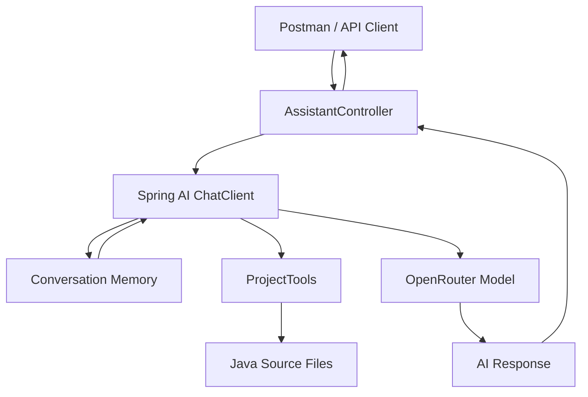
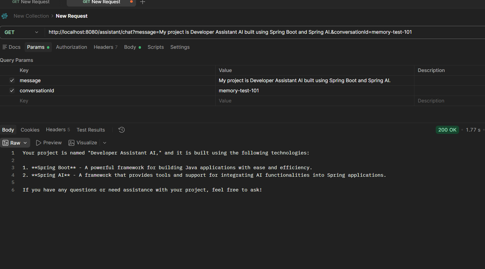
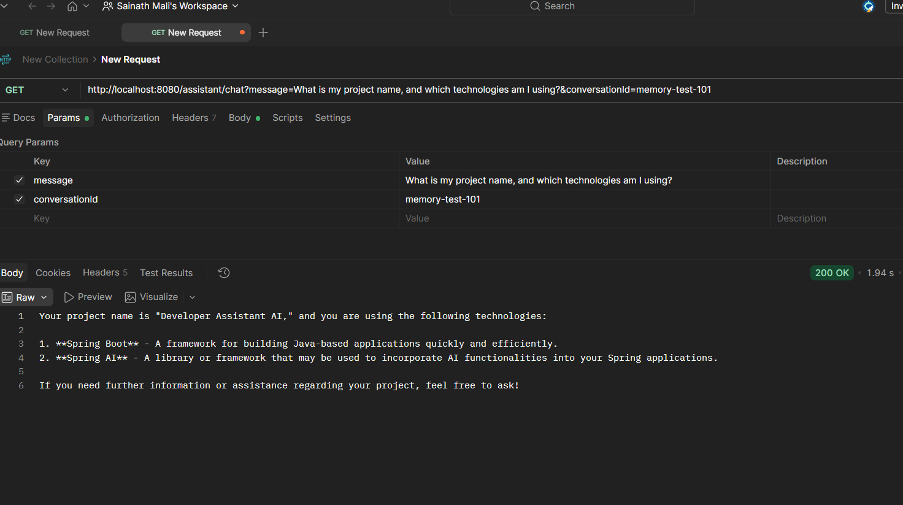

# 🚀 CodeX Assistant — Spring AI Developer Assistant

An AI-powered developer assistant built with **Java 17, Spring Boot, Spring AI, and OpenRouter**. It supports AI chat, conversation memory, and tools that help the assistant explore and explain project source code.


## ✨ Features

- 🤖 **AI Chat:** Ask development-related questions through a REST API.
- 🧠 **Conversation Memory:** Retain conversational context using a conversation ID.
- 📂 **List Project Files:** Find Java source files in the project.
- 🔍 **Search Codebase:** Search Java files for specific keywords.
- 📖 **Read Project Files:** Read and explain permitted source files.
- 🛡️ **System Instructions:** Encourage accurate answers based on project files and conversation history.
- 🔌 **OpenRouter Integration:** Connect to supported AI models using an OpenAI-compatible API.

## 🧰 Tech Stack

| Technology | Purpose |
|---|---|
| Java 17 | Programming language |
| Spring Boot | Backend framework |
| Spring AI | AI integration and tool calling |
| OpenRouter | AI model provider |
| Maven | Dependency management |
| REST API | Communication with the assistant |

## 🏗️ Architecture



## 📂 Project Structure

```text
developer-assistant-ai/
├── src/
│   └── main/
│       ├── java/
│       │   └── com/codex17/developer_assistant/
│       │       ├── controller/
│       │       │   └── AssistantController.java
│       │       ├── tools/
│       │       │   └── ProjectTools.java
│       │       └── DeveloperAssistantAiApplication.java
│       └── resources/
│           └── application.properties
├── screenshots/
│   ├── read-project-file.png
│   ├── conversation-memory.png
│   └── memory-recall.png
├── pom.xml
└── README.md
```

## ⚙️ Getting Started

### Prerequisites

- JDK 17
- Maven
- An OpenRouter API key
- IntelliJ IDEA or VS Code
- Postman (for API testing)

### 1. Clone the repository

Replace `YOUR_USERNAME` with your GitHub username.

```bash
git clone https://github.com/YOUR_USERNAME/assistant-developer.git
cd assistant-developer
```

### 2. Configure the API key

Set your OpenRouter API key as an environment variable.

**Windows PowerShell:**

```powershell
$env:OPENROUTER_API_KEY="your-api-key"
```

Configure `src/main/resources/application.properties`:

```properties
spring.application.name=developer-assistant-ai

spring.ai.openai.base-url=https://openrouter.ai/api/v1
spring.ai.openai.api-key=${OPENROUTER_API_KEY}
spring.ai.openai.chat.options.model=openai/gpt-4o-mini
```

The model identifier is an example; use a model available to your OpenRouter account.

**Important:** Never commit your real API key to GitHub.

### 3. Run the application

```bash
mvn spring-boot:run
```

The application runs at:

`http://localhost:8080`

## 🌐 API Usage

### Chat endpoint

```http
GET http://localhost:8080/assistant/chat
```

| Parameter | Required | Description |
|---|---|---|
| `message` | Yes | Your question or instruction |
| `conversationId` | No | Identifies the conversation; defaults to `Default-session` |

### Example: Ask a question

```http
GET http://localhost:8080/assistant/chat?message=Explain%20Java%20interfaces&conversationId=java-session
```

You can also enter `message` and `conversationId` separately in Postman's **Params** tab.

## 🧠 Conversation Memory

The assistant uses Spring AI's `MessageChatMemoryAdvisor` to provide context across messages.

For messages belonging to the same conversation, use the same `conversationId`.

**Example test:**

1. Send: `My project is Developer Assistant AI built using Spring Boot and Spring AI.`
2. Keep the same conversation ID.
3. Ask: `What is my project name, and which technologies am I using?`

The assistant can use the previous message as conversation context.

### Conversation memory screenshot



### Memory recall screenshot


<<<<<<< HEAD
=======

>>>>>>> 81d29eb137b6b4c60b26ae5e06ca2997a41820a0
> Memory is conversational context, not proof of project facts. The assistant should verify code-related information using project tools where appropriate. Persistence across application restarts depends on the configured memory implementation.

## 🛠️ Project Tools

The `ProjectTools.java` class provides tools # 🚀 CodeX Assistant — Spring AI Developer Assistant

An AI-powered developer assistant built with **Java 17, Spring Boot, Spring AI, and OpenRouter**. It supports AI chat, conversation memory, and tools that help the assistant explore and explain project source code.


## ✨ Features

- 🤖 **AI Chat:** Ask development-related questions through a REST API.
- 🧠 **Conversation Memory:** Retain conversational context using a conversation ID.
- 📂 **List Project Files:** Find Java source files in the project.
- 🔍 **Search Codebase:** Search Java files for specific keywords.
- 📖 **Read Project Files:** Read and explain permitted source files.
- 🛡️ **System Instructions:** Encourage accurate answers based on project files and conversation history.
- 🔌 **OpenRouter Integration:** Connect to supported AI models through an OpenAI-compatible API.

## 🧰 Tech Stack

| Technology | Purpose |
|---|---|
| Java 17 | Programming language |
| Spring Boot | Backend framework |
| Spring AI | AI integration and tool calling |
| OpenRouter | AI model provider |
| Maven | Dependency management |
| REST API | Communication with the assistant |

## 🏗️ Architecture


## 📂 Project Structure

```text
developer-assistant-ai/
├── screenshots/
│   ├── conversation-memory.png
│   ├── memory-recall.png
│   └── read-project-file.png
├── src/
│   ├── main/
│   │   ├── java/
│   │   │   └── com/codex17/developer_assistant/
│   │   │       ├── controller/
│   │   │       │   └── AssistantController.java
│   │   │       ├── tools/
│   │   │       │   └── ProjectTools.java
│   │   │       └── DeveloperAssistantAiApplication.java
│   │   └── resources/
│   │       └── application.properties
│   └── test/
├── pom.xml
└── README.md
```

## ⚙️ Getting Started

### Prerequisites

- JDK 17
- Maven (or the included Maven Wrapper)
- An OpenRouter API key
- IntelliJ IDEA or VS Code
- Postman for API testing

### 1. Clone the repository

```bash
git clone https://github.com/SainathMali/assistant-developer.git
cd assistant-developer
```

### 2. Configure the API key

Set your OpenRouter API key as an environment variable. Never commit your actual API key to GitHub.

**Windows PowerShell:**

```powershell
$env:OPENROUTER_API_KEY="your-api-key"
```

Configure `src/main/resources/application.properties`:

```properties
spring.application.name=developer-assistant-ai

spring.ai.openai.base-url=https://openrouter.ai/api/v1
spring.ai.openai.api-key=${OPENROUTER_API_KEY}
spring.ai.openai.chat.options.model=openai/gpt-4o-mini
```

The model identifier is an example. Use a model supported by your OpenRouter account, and ensure your account has sufficient credits.

### 3. Run the application

From the project root, run:

```powershell
.\mvnw.cmd spring-boot:run
```

Alternatively, if Maven is installed globally:

```bash
mvn spring-boot:run
```

The application runs at:

`http://localhost:8080`

## 🌐 API Usage

### Chat Endpoint

**Method:** `GET`

**Endpoint:**

```text
http://localhost:8080/assistant/chat
```

| Parameter | Required | Description |
|---|---|---|
| `message` | Yes | The question or instruction sent to the assistant |
| `conversationId` | No | Identifies the conversation; defaults to `Default-session` |

### Example Request

```text
http://localhost:8080/assistant/chat?message=Explain%20Java%20interfaces&conversationId=java-session
```

You can also enter the parameters separately in Postman's **Params** tab:

- `message`: `Explain Java interfaces`
- `conversationId`: `java-session`

The assistant returns a response generated by the configured AI model.

## 🧠 Conversation Memory

The assistant uses Spring AI's `MessageChatMemoryAdvisor` to provide context across messages.

To maintain the same conversation, send each related request with the same `conversationId`.

### Example Test

1. Send this message:

   `My project is Developer Assistant AI built using Spring Boot and Spring AI.`

2. Keep the same conversation ID.

3. Ask:

   `What is my project name, and which technologies am I using?`

The assistant can use the previous message as conversation context.

### Conversation Memory Screenshot


### Memory Recall Screenshot


> **Note:** Memory is conversational context, not proof of project facts. Persistence after application restarts depends on the configured memory implementation.

## 🛠️ Project Tools

The `ProjectTools.java` class provides tools for exploring project source code.

| Tool | Purpose |
|---|---|
| `listProjectFiles()` | Lists Java source files. |
| `searchCodebase(keyword)` | Searches Java files for a keyword. |
| `readProjectFile(relativePath)` | Reads an allowed project source file. |

### Reading Project Files Screenshot


### Example Instruction

```text
Use readProjectFile with relativePath
"src/main/java/com/codex17/developer_assistant/controller/AssistantController.java"
and explain the actual code.
```

The assistant can use the returned source content to explain the controller. Actual tool usage depends on the application configuration and the model's tool-calling behavior.

## 🧠 AI Response Guidelines

The assistant is configured with system instructions that encourage it to:

- Use actual project files and conversation history.
- Avoid inventing class names, methods, file paths, or dependencies.
- Avoid claiming to have read files it has not inspected.
- Clearly state when information is missing.
- Distinguish verified facts from assumptions.
- Use project tools when questions require source code.
- Treat conversation memory as context, not proof of project facts.

These instructions help reduce hallucinations but cannot guarantee that every response is correct.

## 🔐 Security Notes

- Store API keys in environment variables.
- Never upload secrets to GitHub.
- Restrict file access to the intended project directory.
- Validate user input.
- Add authentication, authorization, rate limiting, and suitable error handling before public deployment.
- Avoid exposing detailed stack traces to API clients in production.

## 🤝 Contributing

Suggestions, improvements, and bug reports are welcome.

1. Fork the repository.
2. Create a feature branch.
3. Make your changes.
4. Submit a pull request.

## 👨‍💻 About

**CodeX Assistant** is a hands-on project for learning Spring AI, LLM integration, conversation memory, and AI tool calling with Java and Spring Boot.

If you find the project useful, consider giving the repository a ⭐.
for exploring source code.

| Tool | Purpose |
|---|---|
| `listProjectFiles()` | Lists Java source files. |
| `searchCodebase(keyword)` | Searches Java files for a keyword. |
| `readProjectFile(relativePath)` | Reads an allowed project source file. |

### Source file reading screenshot


Example instruction to the assistant:

```text
Use readProjectFile with relativePath
"src/main/java/com/codex17/developer_assistant/controller/AssistantController.java"
and explain the actual code.
```

The assistant can then use the returned source content to explain the controller. Tool availability and results depend on the application's configuration and the model's tool-calling behavior.

## 🧠 AI Response Guidelines

The assistant is configured with system instructions to:

- Use actual project files and conversation history.
- Avoid inventing class names, methods, paths, or dependencies.
- Avoid claiming to have read files it has not inspected.
- Clearly identify missing information.
- Distinguish verified facts from assumptions.
- Use project tools when questions require source code.
- Treat conversation memory as context, not proof.

These instructions help reduce hallucinations but cannot guarantee that every response is correct.

## 🔐 Security Notes

- Store API keys in environment variables.
- Never upload secrets to GitHub.
- Restrict file access to the intended project directory.
- Validate user input.
- Add authentication, authorization, rate limiting, and appropriate error handling before public deployment.

## 🗺️ Roadmap

- [x] Integrate Spring AI with OpenRouter
- [x] Create a chat REST endpoint
- [x] Add conversation memory
- [x] List Java project files
- [x] Search Java source files
- [x] Read and explain source files
- [x] Add project-specific system instructions
- [ ] Improve error handling and API responses
- [ ] Add automated tests
- [ ] Build a web-based chat interface
- [ ] Add Docker support

## 🤝 Contributing

Suggestions, improvements, and bug reports are welcome.

1. Fork the repository.
2. Create a feature branch.
3. Make your changes.
4. Submit a pull request.

## 👨‍💻 About

**CodeX Assistant** is a hands-on project for learning Spring AI, LLM integration, conversation memory, and tool calling with Java and Spring Boot.

If you find the project useful, consider giving the repository a ⭐.
