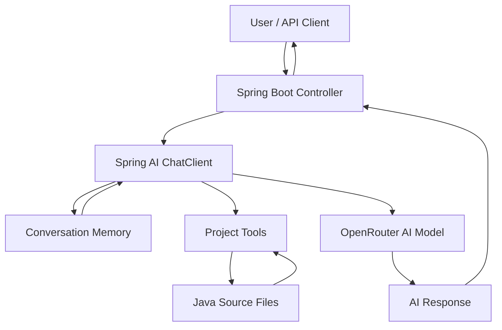

# 🚀 Spring AI Developer Assistant

> An AI-powered developer assistant built with **Spring Boot, Spring AI, and OpenRouter** — designed to answer developer questions, remember conversation context, and interact with project files through custom tools.


## ✨ Features

- 🤖 **AI-Powered Chat** — Interact with an AI model through a REST API.
- 🧠 **Conversation Memory** — Maintain context across messages using conversation IDs.
- 🛠️ **Project Tools** — Custom tools for listing Java files and searching source code.
- 🔍 **Codebase Exploration** — Build toward answering questions about your own source code.
- 🔌 **OpenRouter Integration** — Connect to supported AI models through an OpenAI-compatible API.
- ☕ **Java Backend** — Built using the Spring Boot ecosystem.

## 🧰 Tech Stack

| Technology | Purpose |
|---|---|
| Java 17 | Programming language |
| Spring Boot | Backend application |
| Spring AI | AI integration and tool calling |
| OpenRouter | AI model provider |
| Maven | Dependency management |
| REST API | Client-server communication |

## 🏗️ Architecture



## 📂 Project Structure

```text
developer-assistant-ai/
├── src/
│   └── main/
│       ├── java/
│       │   └── com/codex17/developer_assistant/
│       │       ├── controller/
│       │       │   └── AssistantController.java
│       │       ├── tools/
│       │       │   └── ProjectTools.java
│       │       └── DeveloperAssistantAiApplication.java
│       └── resources/
│           └── application.properties
├── pom.xml
└── README.md
```

## ⚙️ Getting Started

### 1. Prerequisites

Install the following:

- JDK 17
- Maven
- An OpenRouter API key
- IntelliJ IDEA or VS Code

### 2. Clone the repository

```bash
git clone https://github.com/YOUR_USERNAME/assistant-developer.git
cd assistant-developer
```

### 3. Configure the API key

Set your OpenRouter API key as an environment variable. Never commit your real API key to GitHub.

**Windows PowerShell:**

```powershell
$env:OPENROUTER_API_KEY="your-api-key"
```

Configure `src/main/resources/application.properties`:

```properties
spring.application.name=developer-assistant-ai

spring.ai.openai.base-url=https://openrouter.ai/api/v1
spring.ai.openai.api-key=${OPENROUTER_API_KEY}
spring.ai.openai.chat.options.model=openai/gpt-4o-mini
```

Use a model available to your OpenRouter account. The model identifier above is an example.

### 4. Run the application

```bash
mvn spring-boot:run
```

The application should start at:

`http://localhost:8080`

## 🌐 API Usage

### Chat with the assistant

**Endpoint**

```http
GET /assistant/chat
```

**Query parameters**

| Parameter | Required | Description |
|---|---|---|
| `message` | Yes | The question or instruction |
| `conversationId` | No | Identifies the conversation; defaults to `Default-session` |

**Example request**

```http
GET http://localhost:8080/assistant/chat?message=Explain%20Java%20interfaces&conversationId=java-session
```

**Example response**

```text
A Java interface defines a contract that implementing classes must follow.
It can declare abstract methods and also support default and static methods.
```

The response content is generated by the configured AI model; the example above is illustrative.

## 🧠 Conversation Memory

The assistant uses Spring AI's `MessageChatMemoryAdvisor` to provide conversation context.

Example conversation:

```text
User: My Spring Boot version is 4.1.1.
Assistant: Got it.

User: Which version did I tell you?
Assistant: You told me Spring Boot 4.1.1.
```

Use the same `conversationId` for messages that belong to the same conversation.

> **Note:** Memory behavior depends on the configured `ChatMemory` implementation. In-memory history may be lost when the application restarts.

## 🛠️ Project Tools

The project includes custom tools in `ProjectTools.java`.

| Tool | Purpose |
|---|---|
| `listProjectFiles()` | Lists Java source files |
| `searchCodebase(keyword)` | Searches Java source files for a keyword |

These tools provide a foundation for adding deeper code understanding, source-file reading, and project analysis.

## 🔐 Security Notes

- Store API keys in environment variables.
- Never commit secrets to GitHub.
- Validate user input.
- Restrict file access to the intended project directory.
- Consider authentication, authorization, and rate limiting before public deployment.

## 🗺️ Roadmap

- [x] Integrate Spring AI with OpenRouter
- [x] Create a chat REST endpoint
- [x] Add conversation memory
- [x] Create basic project tools
- [ ] Read and explain individual source files
- [ ] Inspect `pom.xml` and identify dependencies
- [ ] Add code debugging assistance
- [ ] Build a web-based chat interface
- [ ] Add automated tests and Docker support

## 🤝 Contributing

Contributions, suggestions, and bug reports are welcome.

1. Fork the repository.
2. Create a feature branch.
3. Make your changes.
4. Submit a pull request.

## 👨‍💻 Author

**Project:** Spring AI Developer Assistant

Built as a hands-on project to learn Spring AI, LLM integration, conversation memory, and AI tool calling.

---

⭐ If you find this project useful, consider giving the repository a star.
